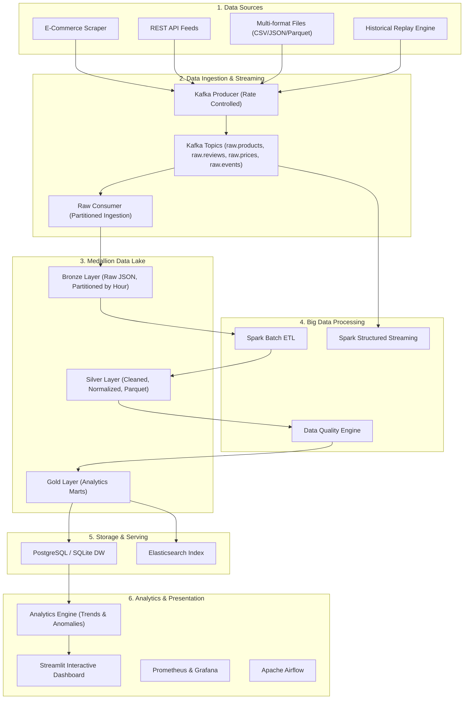

# SentinelAI — Agentic Multimodal Big Data Intelligence Platform

## Phase 1 Status: Under Active Development

### ✅ Completed
- [x] Schema design & data contracts (JSON Schema validation)
- [x] Multi-format data ingestion (CSV, JSON, JSONL, Parquet)
- [x] E-commerce crawler ecosystem (Tiki, Universal, Mock)
- [x] Kafka real producer with message envelope (event_id, event_type, source, ingested_at, payload)
- [x] Kafka consumer with manual offset commit and DLQ
- [x] MinIO storage backend with local fallback
- [x] Batch ETL pipeline (Clean -> Normalize -> Deduplicate -> Validate)  
- [x] Price pipeline
- [x] Gold analytics marts (product_daily_stats, brand_daily_stats, category_daily_stats, price_daily_stats)
- [x] PostgreSQL warehouse with UPSERT
- [x] Spark Structured Streaming (windowed aggregation with watermark)
- [x] Anomaly detection (Review Burst, Price Anomaly, Rating Drop)
- [x] Data Quality evaluator with per-rule metrics
- [x] Streamlit dashboard
- [x] 3V Benchmark suite
- [x] Airflow DAG orchestration
- [x] 65+ unit tests passing

### 🔄 Infrastructure Requirements  
- Docker Compose with Kafka (KRaft), MinIO, Spark, PostgreSQL, Elasticsearch
- `pip install -r requirements.txt`

### Architecture



## 🚀 Quickstart Guide

### 1. Prerequisites & Environment
```bash
# Clone the repository
git clone https://github.com/ptdbrain/Agentic_Multimodal_Big_Data_Intelligence_Platform.git
cd Agentic_Multimodal_Big_Data_Intelligence_Platform

# Install Python requirements
pip install -r requirements.txt
```

### 2. Run the End-to-End Pipeline
Executes data generation, Bronze ingestion, Spark batch ETL, Data Quality evaluation, Anomaly Detection, and Gold DW sync in one command:
```bash
python scripts/run_e2e_pipeline.py
```

### 3. Launch Interactive Streamlit Dashboard
```bash
streamlit run dashboard/app.py
```

### 4. Run Test Suite
```bash
pytest -v
```

## 👥 Author
**PTDBrain** — *phandat20052009@gmail.com*

## Correctness and verification

Supported verification runtime: Python 3.11, Java 17, Spark 3.5.0. Install the bounded dependencies in `requirements.txt`; arbitrary newer pandas/NumPy/PyArrow releases are not the tested Spark serialization stack.

```bash
make test-unit         # isolated logic and dashboard smoke; no JVM/services
make test-spark        # actual local JVM, batch/Gold/replay/file checkpoint tests
make test-integration  # requires Kafka, MinIO, PostgreSQL and Elasticsearch
pytest tests/integration/test_airflow_execution.py -v  # dedicated Airflow LocalExecutor metadata DB
```

Live API collection requires `endpoint_url` and a response containing `data`, `page` and `has_next`. Simulation requires `mock_mode=True`. Search uses Elasticsearch REST in integration/production; select `backend="memory"` explicitly for a local-only index. A service failure is never silently converted into synthetic data or an in-memory success.

`data/manifest.json` records artifact hashes and origin labels separately. Existing public/crawler snapshots are **unverified**, not authenticated by their IDs. Canonical multi-format sample fixtures live in `data/fixtures/canonical`; legacy files were preserved. Inspect drift or create a new fixture set with `scripts/sync_sample_formats.py` (dry-run unless `--apply` is supplied, refuses existing output files).

The classic pipeline uses a durable canonical-output lease and per-path writer locks. A crashed DAG retains its lease for explicit recovery; do not steal it while an earlier worker might still be running. Classic Parquet directory publication is recoverable, not a multi-reader atomic transaction. Lakehouse snapshots use a separate transactional SQL catalog (SQLite locally, PostgreSQL with MinIO), enforce a fixed schema and reject concurrent-version conflicts. Legacy JSON logs require the explicit dry-run/import command `python scripts/migrate_lakehouse_metadata.py TABLE [--apply]`; this custom format is not Delta Lake.

See [remediation validation status](docs/reports/remediation_status.md) for executed evidence and remaining external-service validation.

## Source layout

The source tree is now in `btl/`; Git and GitHub Actions remain at its parent. Start development commands with `cd btl`. Python configuration prefers `btl/.env` and otherwise loads the parent Git repository's `.env`; `make up`/`make down` use the same environment-file priority. CI run steps execute inside `btl/`.

MinIO is built from the upstream `RELEASE.2024-03-30T09-41-56Z` source using `docker/minio.Dockerfile`, with a SHA256-pinned source archive. The verification environment encountered registry pull failures for that release. Run `docker compose build minio` before starting the stack; the build needs network access to fetch source and Go dependencies. This is a source build of MinIO, not a substitute S3 server.

Gold reads are strict by default. `SparkGoldBuilder(allow_local_fallback=True)` enables a pandas fallback only in local/test mode and only for a missing implicit Silver path. Permission, schema, connector and supplied-path failures propagate. Integration/production reject this opt-in.
