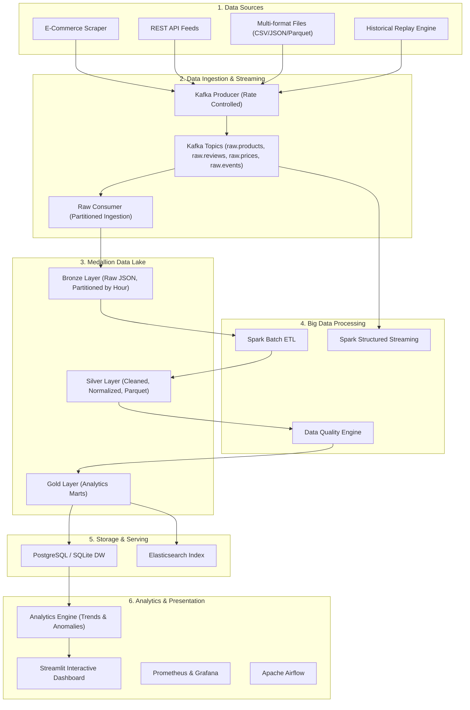

# SentinelAI — Agentic Multimodal Big Data Intelligence Platform

Kế hoạch bàn giao hiện tại ghi phạm vi Giai đoạn 1, tiêu chí thu web, phép đo hiệu năng và lịch nghiệm thu vận hành. [Kế hoạch hoàn thiện](docs/superpowers/plans/2026-11-21-project-completion.md) · [Báo cáo nghiệm thu mới nhất](docs/reports/project_completion_evening_2026-11-26.md)

## Current scope and status

The current implementation covers non-AI ingestion, processing, statistical analytics and serving. Sources are managed separately: observed marketplace data, observed web articles and explicitly labelled simulation. Currency values retain their source units. Collection cadence and processing latency are separate measurements.

The Docker deployment owns source scheduling and serves the dashboard. It includes dataset-bound dashboard sessions, SQL streaming receipts, statistical alerts, transactional Elasticsearch publishing and verified input lineage. **Phase 1 operational acceptance remains open** while hourly checks measure the 72-hour observation period. [Acceptance criteria and evidence](docs/reports/project_completion_evening_2026-11-26.md)

Integration/production require actual Kafka, MinIO, PostgreSQL and Elasticsearch. Local/test storage must be selected explicitly; service failures do not silently switch to local data or simulation.

### Architecture



## 🚀 Quickstart Guide

### 1. Prerequisites & Environment
```bash
# Clone the repository
git clone https://github.com/ptdbrain/Agentic_Multimodal_Big_Data_Intelligence_Platform.git
cd Agentic_Multimodal_Big_Data_Intelligence_Platform

# Install Python requirements
pip install -r requirements.txt
```

### 2. Prepare the isolated application stack

From `btl`, prepare a new private directory and validate the Compose configuration:

```bash
python scripts/prepare_application.py --directory ../.runtime/nonai-docker-private
docker compose --env-file ../.runtime/nonai-docker-private/compose.env -p sentinel-nonai config --quiet
docker compose --env-file ../.runtime/nonai-docker-private/compose.env -p sentinel-nonai up -d --build
```

The preparation command refuses existing directories. Keep these private files out of Git. New DAGs remain paused; confirm source ownership before enabling collection. Dashboard staging uses port 18502 and Grafana uses 13000. See the [run instructions and remaining acceptance work](docs/non-ai-completion.md).

### 3. Local development and tests

```bash
streamlit run dashboard/app.py
make test-unit
make test-spark
```

Use `SERVING_DATASETS_CONFIG` with private connection references for independent source selectors. An unconfigured legacy dashboard keeps its existing connection. The end-to-end CLI requires an explicitly configured source/runtime; running it is not a substitute for deployment acceptance.

## 👥 Author
**PTDBrain** — *phandat20052009@gmail.com*

## Correctness and verification

Supported verification runtime: Python 3.11, Java 17, Spark 3.5.0. Install the bounded dependencies in `requirements.txt`; arbitrary newer pandas/NumPy/PyArrow releases are not the tested Spark serialization stack.

```bash
make test-unit         # isolated logic and dashboard smoke; no JVM/services
make test-spark        # actual local JVM, batch/Gold/replay/file checkpoint tests
make test-integration  # requires Kafka, MinIO, PostgreSQL and Elasticsearch
pytest tests/integration/test_airflow_execution.py -v  # dedicated Airflow LocalExecutor metadata DB
```

Live API collection requires `endpoint_url` and a response containing `data`, `page` and `has_next`. Simulation requires `mock_mode=True`. Search uses Elasticsearch REST in integration/production; select `backend="memory"` explicitly for a local-only index. A service failure is never silently converted into synthetic data or an in-memory success.

`data/manifest.json` records artifact hashes and origin labels separately. Existing public/crawler snapshots are **unverified**, not authenticated by their IDs. Canonical multi-format sample fixtures live in `data/fixtures/canonical`; legacy files were preserved. Inspect drift or create a new fixture set with `scripts/sync_sample_formats.py` (dry-run unless `--apply` is supplied, refuses existing output files).

The classic pipeline uses a durable canonical-output lease and per-path writer locks. A crashed DAG retains its lease for explicit recovery; do not steal it while an earlier worker might still be running. Classic Parquet directory publication is recoverable, not a multi-reader atomic transaction. Lakehouse snapshots use a separate transactional SQL catalog (SQLite locally, PostgreSQL with MinIO), enforce a fixed schema and reject concurrent-version conflicts. Legacy JSON logs require the explicit dry-run/import command `python scripts/migrate_lakehouse_metadata.py TABLE [--apply]`; this custom format is not Delta Lake.

See [remediation validation status](docs/reports/remediation_status.md) for executed evidence and remaining external-service validation.

## Source layout

The source tree is now in `btl/`; Git and GitHub Actions remain at its parent. Start development commands with `cd btl`. Python configuration prefers `btl/.env` and otherwise loads the parent Git repository's `.env`; `make up`/`make down` use the same environment-file priority; use `COMPOSE_ENV=../.runtime/nonai-docker-private/compose.env` for the new application stack. CI run steps execute inside `btl/`.

MinIO is built from the upstream `RELEASE.2024-03-30T09-41-56Z` source using `docker/minio.Dockerfile`, with a SHA256-pinned source archive. The verification environment encountered registry pull failures for that release. Run the Compose build with the private `--env-file` shown above; the build needs network access to fetch source and Go dependencies. This is a source build of MinIO, not a substitute S3 server.

Gold reads are strict by default. `SparkGoldBuilder(allow_local_fallback=True)` enables a pandas fallback only in local/test mode and only for a missing implicit Silver path. Permission, schema, connector and supplied-path failures propagate. Integration/production reject this opt-in.
