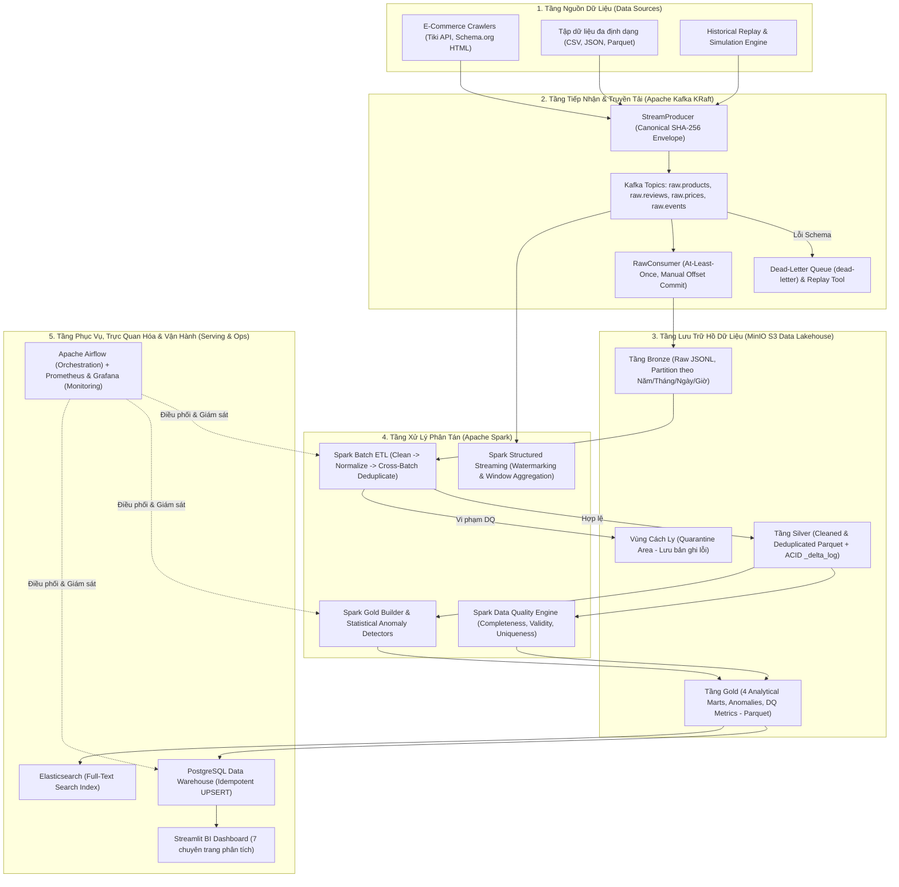

# BÁO CÁO ĐỀ XUẤT DỰ ÁN MÔN HỌC DỮ LIỆU LỚN (BIG DATA)

## 1. Thông Tin Chung Về Dự Án

- **Tên đề tài (Tiếng Việt):** Hệ thống Thu thập, Xử lý Dữ liệu lớn Đa nguồn và Phát hiện Bất thường Thương mại Điện tử theo Thời gian thực (SentinelAI)
- **Tên đề tài (Tiếng Anh):** *SentinelAI — Enterprise Big Data Intelligence & E-Commerce Anomaly Detection Platform*
- **Lĩnh vực ứng dụng:** Kỹ thuật Dữ liệu lớn (Big Data Engineering), Kiến trúc Medallion Data Lakehouse, Phân tích Thương mại Điện tử (E-Commerce Intelligence).

---

## 2. Đặt Vấn Đề & Bài Toán Cần Giải Quyết (Problem Statement)

### 2.1. Bối cảnh thực tiễn
Thị trường Thương mại Điện tử (TMĐT) tại Việt Nam (như Tiki, Shopee, Lazada) và các diễn đàn công nghệ (Tinhte, Voz) tạo ra khối lượng dữ liệu khổng lồ mỗi ngày, bao gồm danh mục sản phẩm, lịch sử biến động giá theo từng giờ và hàng triệu lượt đánh giá (reviews) từ người tiêu dùng. Tuy nhiên, cả người mua lẫn nhà quản lý sàn đang đối mặt với nhiều hiện tượng bất thường và gian lận dữ liệu:

1. **Thao túng giá và khuyến mãi ảo (Price Gouging & Fake Discounts):** Một số nhà bán hàng tăng giá đột biến trước các đợt khuyến mãi lớn để tạo mức giảm giá ảo, hoặc điều chỉnh giá bất thường lệch khỏi mặt bằng chung của thị trường.
2. **Thao túng đánh giá & Bão đánh giá (Review Bombing & Seeding Bursts):** Hiện tượng một sản phẩm nhận hàng trăm đánh giá 5 sao giả mạo (seeding) hoặc bị đối thủ tấn công 1 sao hàng loạt (review bombing) chỉ trong vài giờ.
3. **Sụt giảm chất lượng sản phẩm đột ngột (Sudden Rating Drops):** Sản phẩm đang có chất lượng ổn định bỗng nhiên bị tụt điểm đánh giá trung bình nghiêm trọng do lỗi lô hàng hoặc thay đổi nhà cung cấp nhưng không được cảnh báo sớm.

### 2.2. Thách thức về mặt Kỹ thuật Dữ liệu lớn (Bài toán 3V)
Các giải pháp phân tích truyền thống (sử dụng script Python/Pandas đọc ghi trực tiếp trên một cơ sở dữ liệu đơn lẻ) không thể giải quyết bài toán này ở quy mô lớn vì 3 thách thức đặc trưng của Big Data:
- **Volume (Khối lượng lớn):** Dữ liệu lịch sử tích lũy từ hàng trăm nghìn đến hàng triệu bản ghi sản phẩm, lịch sử giá và đánh giá theo chuỗi thời gian.
- **Velocity (Tốc độ cao):** Dữ liệu sự kiện (cập nhật giá, đánh giá mới) đổ về liên tục theo luồng (streaming) với tần suất từ hàng chục đến hàng trăm sự kiện mỗi giây, đòi hỏi khả năng xử lý theo cửa sổ thời gian thực (windowed streaming).
- **Variety (Đa dạng nguồn và định dạng):** Dữ liệu đầu vào không đồng nhất (HTML từ web crawler, JSON từ REST API, CSV/JSONL/Parquet từ các tập dữ liệu lịch sử), chứa cả dữ liệu có cấu trúc (giá, điểm số) và phi cấu trúc (văn bản đánh giá song ngữ Việt - Anh), đi kèm nhiều dữ liệu nhiễu, khuyết thiếu hoặc trùng lặp.

**$\Rightarrow$ Mục tiêu của dự án SentinelAI:** Xây dựng một đường ống dữ liệu lớn (End-to-End Big Data Pipeline) hoàn chỉnh theo kiến trúc **Medallion (Bronze – Silver – Gold)** kết hợp xử lý theo lô (**Batch Processing**) và xử lý luồng thời gian thực (**Stream Processing**) để tự động thu thập, làm sạch, kiểm định chất lượng dữ liệu và phát hiện các bất thường về giá, đánh giá trên sàn TMĐT.

---

## 3. Kiến Trúc Tổng Thể & Công Nghệ Sử Dụng (Tech Stack)

### 3.1. Sơ đồ kiến trúc hệ thống

### 3.2. Danh mục Công nghệ sử dụng (Tech Stack)

| Tầng chức năng | Công nghệ / Thư viện | Vai trò trong dự án |
| :--- | :--- | :--- |
| **Thu thập dữ liệu (Ingestion)** | `Python`, `Requests`, `JSON Schema`, `PyArrow` | Thu thập dữ liệu từ API/Web, nạp file đa định dạng (CSV/JSON/Parquet), kiểm tra hợp đồng dữ liệu (Data Contracts) ngay tại đầu vào. |
| **Truyền tải thông điệp (Message Broker)** | **Apache Kafka 3.7 (KRaft Mode)**, `kafka-python` | Tiếp nhận luồng sự kiện tốc độ cao không cần ZooKeeper, phân tách Producer và Consumer, quản lý hàng đợi lỗi (Dead-Letter Queue). |
| **Lưu trữ phân tán (Data Lakehouse)** | **MinIO (S3-Compatible Object Storage)**, **Apache Parquet**, Custom `_delta_log` | Lưu trữ dữ liệu phân tầng Bronze – Silver – Gold tương thích chuẩn AWS S3, nén dữ liệu dạng cột Parquet, hỗ trợ kiểm tra lịch sử phiên bản (Time Travel). |
| **Xử lý dữ liệu lớn (Distributed Compute)** | **Apache Spark 3.5 (PySpark - Batch & Structured Streaming)** | Thực hiện ETL phân tán quy mô lớn, khử trùng lặp xuyên lô (Cross-Batch Deduplication), đánh giá Data Quality và tính toán cửa sổ thời gian thực. |
| **Kho dữ liệu & Tìm kiếm (Serving Layer)** | **PostgreSQL 16**, **Elasticsearch 8.13** | PostgreSQL làm Data Warehouse lưu trữ các bảng Gold Marts phục vụ truy vấn BI; Elasticsearch phục vụ tìm kiếm toàn văn (Full-text search) trên đánh giá. |
| **Phân tích & Phát hiện bất thường** | `PySpark SQL`, `NumPy`, `Pandas` | Triển khai các mô hình thống kê phát hiện bất thường: $Z\text{-Score}$, $\text{IQR}$ (biến động giá), $\mu + k\sigma$ (Review Burst/Bombing), và trượt trung bình động (Rating Drop). |
| **Trực quan hóa (BI Dashboard)** | **Streamlit**, **Plotly** | Xây dựng ứng dụng Dashboard tương tác gồm 7 trang chuyên biệt hiển thị KPI, xu hướng thị trường, cảnh báo bất thường và điểm chất lượng dữ liệu. |
| **Điều phối & Giám sát (Orchestration & Ops)** | **Apache Airflow**, **Prometheus**, **Grafana**, **Docker Compose**, `Pytest` | Tự động hóa lịch chạy pipeline hàng ngày bằng DAG, thu thập telemetry hệ thống, đóng gói toàn bộ hạ tầng bằng Container và kiểm thử tự động (65+ tests). |

---

## 4. Nguồn Dữ Liệu Đầu Vào & Cơ Chế Thu Thập (Data Sources & Ingestion)

### 4.1. Nguồn dữ liệu (Data Origins)
Hệ thống kết hợp 3 nhóm nguồn dữ liệu để đảm bảo cả tính thực tế lẫn khả năng kiểm thử tải lớn (3V Benchmark):
1. **Dữ liệu thực tế từ sàn TMĐT & Diễn đàn (Live Crawlers):**
   - **Tiki Crawler (`ingestion/crawler/tiki.py`):** Thu thập thông tin sản phẩm, lịch sử giá và đánh giá người dùng thực tế từ danh mục thiết bị điện tử/công nghệ.
   - **Universal HTML Crawler (`ingestion/crawler/generic_html.py`):** Trích xuất dữ liệu chuẩn Schema.org và bài thảo luận từ các trang web/diễn đàn công nghệ.
   - *Nguyên tắc thu thập văn minh & bảo mật:* Tuân thủ tuyệt đối `robots.txt`, giới hạn tốc độ ($\le 2$ requests/s kèm Random Jitter), cơ chế thử lại hàm mũ (Exponential Backoff) khi gặp mã lỗi `429/503`, và **ẩn danh hóa thông tin cá nhân (PII)** bằng hàm băm một chiều $\text{user\_id} = \text{sha256}(\text{raw\_user\_id} + \text{salt})[:16]$.
2. **Tập dữ liệu lịch sử đa định dạng (`ingestion/file_loader/`):**
   - Hỗ trợ đọc các tập dữ liệu công khai (Public E-commerce Datasets) ở định dạng **CSV, JSON, JSONL, Parquet** để nạp dữ liệu lịch sử quy mô lớn (100.000 – 1.000.000+ bản ghi).
3. **Bộ giả lập và phát lại luồng sự kiện (`data/generator.py`, `scripts/benchmark.py`):**
   - Phát lại (Replay) dữ liệu lịch sử thành luồng sự kiện thời gian thực với tốc độ điều chỉnh được (từ $10$ đến $1.000\text{ messages/s}$) để kiểm thử khả năng chịu tải và độ trễ của Kafka & Spark Streaming.

### 4.2. Các thực thể dữ liệu chính (Domain Entities)
- **Products (`raw.products`):** `product_id`, `product_name`, `brand`, `category`, `subcategory`, `price`, `currency`, `rating`, `review_count`, `seller`, `source`.
- **Reviews (`raw.reviews`):** `review_id`, `product_id`, `rating` ($[1.0, 5.0]$), `review_title`, `review_text`, `review_date`, `verified_purchase`, `helpful_count`, `source`.
- **Prices (`raw.prices`):** `price_id`, `product_id`, `price` ($>0$), `currency`, `seller`, `timestamp`, `source`.
- **System Events (`raw.events`):** Các sự kiện vận hành và theo dõi trạng thái luồng.

### 4.3. Đóng gói thông điệp và Kiểm soát đầu vào qua Kafka
- **Canonical Message Envelope:** Trước khi gửi vào Kafka, mọi bản ghi được bọc trong một phong bì chuẩn hóa gồm: `event_id`, `event_type`, `schema_version`, `source`, `event_time`, `ingested_at`, và `payload`. Trong đó, mã định danh `event_id` được sinh tất định theo công thức:
  $$\text{event\_id} = \text{evt\_} + \text{sha256}(\text{source} \mid \text{entity\_id} \mid \text{event\_time})[:24]$$
  giúp đảm bảo tính **Idempotency** (chạy lại nhiều lần không sinh dữ liệu rác trùng lặp).
- **Dead-Letter Queue (`dead-letter`):** Các bản ghi không vượt qua bước kiểm tra hợp đồng dữ liệu (JSON Schema Validation) tại tầng tiếp nhận sẽ được đẩy sang topic `dead-letter` kèm nguyên nhân lỗi để xử lý và phát lại (Replay) sau, đảm bảo luồng chính không bị gián đoạn.

---

## 5. Quy Trình Xử Lý Dữ Liệu (Data Processing Pipeline)

Hệ thống áp dụng kiến trúc lai kết hợp **Xử lý theo lô (Batch Processing)** và **Xử lý luồng (Stream Processing)** bằng **Apache Spark**:

### 5.1. Luồng xử lý theo lô (Spark Batch ETL: Bronze $\rightarrow$ Silver)
Đọc dữ liệu thô từ tầng Bronze trên MinIO và thực thi chuỗi xử lý 4 bước:
1. **Làm sạch dữ liệu (Data Cleaning - `spark/etl/cleaner.py`):**
   - Cắt bỏ khoảng trắng thừa, chuẩn hóa chuỗi ký tự Unicode, loại bỏ các ký tự điều khiển lỗi.
   - Xử lý giá trị khuyết thiếu (Null/NaN) và lọc bỏ các bản ghi vi phạm miền giá trị vật lý (ví dụ: $\text{price} \le 0$ hoặc $\text{rating} \notin [1.0, 5.0]$).
2. **Chuẩn hóa dữ liệu (Normalization - `spark/etl/normalizer.py`):**
   - Chuẩn hóa tên thương hiệu về dạng chính tắc (ví dụ: `"samsung"`, `"SAMSUNG Electronics"` $\rightarrow$ `"Samsung"`).
   - Đồng nhất đơn vị tiền tệ về `VND` và chuẩn hóa toàn bộ nhãn thời gian (`timestamp`, `review_date`) về chuẩn **ISO-8601 UTC**.
3. **Khử trùng lặp xuyên lô (Cross-Batch Deduplication - `spark/etl/deduplicator.py`):**
   - Kết hợp dữ liệu lô mới (incremental batch) với dữ liệu hiện có tại tầng Silver, sử dụng hàm cửa sổ ` Window.partitionBy(primary_key).orderBy(col("timestamp").desc())` của Spark để chỉ giữ lại trạng thái mới nhất của mỗi `product_id`, `review_id`, `price_id`.
4. **Đánh giá Chất lượng Dữ liệu & Cách ly (Data Quality & Quarantine - `spark/quality/spark_dq.py`):**
   - Chấm điểm chất lượng tự động dựa trên bộ quy tắc (Rule Engine) theo 3 tiêu chí: **Tính đầy đủ (Completeness)**, **Tính hợp lệ (Validity)** và **Tính duy nhất (Uniqueness)**.
   - Tính điểm tổng hợp $\text{DQ Score} \in [0, 100\%]$ cho từng batch. Các bản ghi hợp lệ được ghi vào tầng **Silver**; các bản ghi lỗi được tách riêng vào vùng **Quarantine (`sentinel-data/quarantine/`)** kèm nhãn lỗi để phục vụ kiểm toán.

### 5.2. Luồng tổng hợp & Phát hiện bất thường (Spark Analytics: Silver $\rightarrow$ Gold)
Từ dữ liệu sạch ở tầng Silver, hệ thống thực hiện:
1. **Xây dựng các Data Marts tổng hợp (`spark/analytics/gold_builder.py`):**
   - `product_daily_stats`: Thống kê theo sản phẩm & ngày (số lượng đánh giá, điểm trung bình, độ lệch chuẩn điểm số, tỷ lệ đánh giá tích cực/tiêu cực, giá thấp nhất/cao nhất/trung bình).
   - `brand_daily_stats`: Thống kê sức khỏe thương hiệu theo ngày (tổng số sản phẩm, tổng đánh giá, điểm đánh giá trung bình, mức giá trung bình).
   - `category_daily_stats`: Phân tích xu hướng theo ngành hàng.
   - `price_daily_stats`: Chuỗi thời gian biến động giá (`min_price`, `max_price`, `avg_price`, `price_std`, `data_points`).
2. **Phát hiện bất thường bằng mô hình thống kê (`analytics/anomaly/`):**
   - **Bất thường về giá (`PriceAnomalyDetector`):** Kết hợp kiểm định $Z\text{-Score}$ ($\left|\frac{x - \mu}{\sigma}\right| \ge 2.5$) và phương pháp khoảng tứ phân vị $\text{IQR}$ ($x \notin [Q_1 - 1.5\times\text{IQR}, Q_3 + 1.5\times\text{IQR}]$) để phát hiện các đợt tăng/giảm giá đột biến hoặc định giá ảo.
   - **Bão đánh giá & Seeding (`ReviewBurstDetector`):** Nhóm số lượng đánh giá theo khung giờ, so sánh với đường cơ sở lịch sử (loại trừ điểm đang xét để tránh tự làm lệch chuẩn): phát hiện đột biến khi lưu lượng vượt ngưỡng $\mu_{\text{baseline}} + k \cdot \sigma_{\text{baseline}}$. Nếu điểm trung bình trong khung giờ đó $\le 2.0$, hệ thống phân loại là **`REVIEW_BOMBING`** (tấn công tiêu cực); ngược lại là **`REVIEW_BURST`**.
   - **Sụt giảm điểm đánh giá (`RatingAnomalyDetector`):** Sử dụng cửa sổ trượt (Rolling Window $N$ ngày) để tính điểm trung bình cơ sở và phát hiện các ngày có độ sụt giảm $\Delta = \text{Rating}_{\text{baseline}} - \text{Rating}_{\text{current}} \ge \text{Threshold}$.

### 5.3. Luồng xử lý thời gian thực (Spark Structured Streaming)
- Đọc trực tiếp luồng sự kiện từ Kafka (`spark/streaming/spark_streaming_job.py`).
- Áp dụng **Watermarking** (xử lý dữ liệu đến trễ) và gom nhóm theo **Tumbling/Sliding Windows** (cửa sổ 1 phút và 5 phút) để theo dõi thông lượng sự kiện theo thời gian thực và phát cảnh báo sớm ngay khi lưu lượng vượt ngưỡng.

---

## 6. Kiến Trúc Lưu Trữ Dữ Liệu (Storage Architecture)

Hệ thống tổ chức lưu trữ theo mô hình **Medallion Data Lakehouse** kết hợp **Serving Data Warehouse**:

1. **MinIO Object Storage (Data Lake chuẩn S3):**
   - **Tầng Bronze (`sentinel-data/bronze/{topic}/year=YYYY/month=MM/day=DD/hour=HH/`):** Lưu trữ dữ liệu thô nguyên bản (Append-only JSONL). Raw Consumer chỉ commit offset lên Kafka sau khi đã ghi thành công xuống MinIO (đảm bảo ngữ nghĩa *At-Least-Once Delivery*).
   - **Tầng Silver (`sentinel-data/silver/{entity}/`):** Lưu trữ dữ liệu sạch dưới định dạng cột **Apache Parquet** giúp giảm ~75% dung lượng lưu trữ và tăng tốc độ quét cột. Tích hợp lớp quản lý bảng **Lakehouse (`storage/lakehouse.py`)** ghi nhật ký giao dịch ACID vào `_delta_log/*.json`, cho phép truy vấn lịch sử theo phiên bản (**Time Travel**) và cập nhật nguyên tử (Atomic Upsert).
   - **Tầng Gold (`sentinel-data/gold/{mart_name}/`):** Lưu trữ 4 bảng Data Marts, bảng sự kiện bất thường (`anomaly_events`) và bảng chỉ số chất lượng (`data_quality_metrics`) dưới dạng Parquet.
   - **Tầng Quarantine (`sentinel-data/quarantine/`):** Lưu trữ các bản ghi không đạt chuẩn chất lượng dữ liệu.
2. **PostgreSQL Data Warehouse (Serving Layer):**
   - Các bảng Gold Marts được đồng bộ sang PostgreSQL (`sentinel_dw`) thông qua cơ chế **Idempotent UPSERT (`INSERT ... ON CONFLICT DO UPDATE`)**.
   - Được thiết kế tối ưu với khóa chính tổ hợp và các chỉ mục (`INDEX` theo ngày, mã sản phẩm, thời gian bất thường) để phục vụ truy vấn phân tích từ Dashboard với độ trễ mili-giây.
3. **Elasticsearch (Search Layer):**
   - Đánh chỉ mục văn bản cho sản phẩm và nội dung đánh giá, hỗ trợ tìm kiếm nhanh theo từ khóa và ngữ cảnh.

---

## 7. Kết Quả Mong Muốn & Sản Phẩm Bàn Giao (Expected Outcomes & Deliverables)

Khi hoàn thành, dự án mang lại các kết quả cụ thể và có thể kiểm chứng thực nghiệm:

1. **Hệ thống Pipeline Big Data End-to-End vận hành thực tế:**
   - Toàn bộ các thành phần **Kafka, MinIO, Apache Spark, PostgreSQL, Elasticsearch** được đóng gói qua `docker-compose.yml` và nằm trực tiếp trên đường đi của dữ liệu (không giả lập thủ công).
   - Tự động hóa hoàn toàn quy trình chạy hàng ngày thông qua **Apache Airflow DAG (`sentinel_daily_pipeline`)**.
2. **Bằng chứng thực nghiệm đạt chuẩn 3V (3V Empirical Benchmark):**
   - **Volume:** Xử lý từ $100.000$ đến $>1.000.000$ bản ghi với tốc độ xử lý Spark Batch đạt $>100.000\text{ bản ghi/giây}$ ở chế độ phân tán cột Parquet.
   - **Velocity:** Đáp ứng luồng tiếp nhận Kafka liên tục từ $10$ đến $500+\text{ sự kiện/giây}$ và xử lý cửa sổ thời gian thực trên Spark Structured Streaming.
   - **Variety:** Xử lý đồng thời 4 định dạng (CSV, JSON, JSONL, Parquet) và đa nguồn dữ liệu (Web Crawler, API, Replay Stream).
3. **Hệ thống Quản trị Chất lượng Dữ liệu (Data Governance & Quality):**
   - Đạt điểm chất lượng dữ liệu ($\text{DQ Score}$) đầu ra tại tầng Silver/Gold ở mức $100\%$ nhờ cơ chế lọc và cách ly tự động các bản ghi lỗi sang vùng Quarantine và Dead-Letter Queue.
   - Đảm bảo tính truy vết nguồn gốc dữ liệu (**Data Lineage**) từ biểu đồ trên Dashboard ngược về tận bản ghi thô ở tầng Bronze.
4. **Ứng dụng Dashboard Phân tích Tương tác (Streamlit BI Dashboard):**
   - Gồm **7 trang chức năng chuyên biệt** truy vấn trực tiếp từ PostgreSQL Data Warehouse:
     - *1. Overview:* Tổng quan KPI toàn hệ thống (tổng sản phẩm, đánh giá, điểm trung bình, số cảnh báo bất thường).
     - *2. Pipeline:* Giám sát trạng thái vận hành và thông lượng của từng chặng trong pipeline.
     - *3. Products:* Phân tích chi tiết danh mục sản phẩm, thương hiệu và nhà bán.
     - *4. Reviews:* Phân tích phân phối điểm số và nội dung đánh giá của khách hàng.
     - *5. Trends:* Biểu đồ chuỗi thời gian theo dõi xu hướng biến động giá và điểm đánh giá theo ngành hàng/thương hiệu.
     - *6. Anomalies:* Trung tâm cảnh báo sớm hiển thị chi tiết các sự kiện bất thường (`PRICE_ANOMALY`, `PRICE_IQR_OUTLIER`, `REVIEW_BURST`, `REVIEW_BOMBING`, `RATING_DROP`) kèm điểm số rủi ro.
     - *7. Data Quality:* Bảng điểm chất lượng dữ liệu (Completeness, Validity, Uniqueness) qua từng đợt chạy batch.
5. **Độ tin cậy kỹ thuật & Khả năng mở rộng (Testing & Future Roadmap):**
   - Bộ kiểm thử tự động gồm **65+ Unit & Integration Tests** (`pytest`) kiểm tra toàn diện từ Schema, Ingestion, Spark ETL, Data Quality đến Anomaly Detection.
   - **Nền tảng sẵn sàng cho các giai đoạn mở rộng AI (Phase 2 – 4):** Tích hợp mô hình ngôn ngữ tiếng Việt (**PhoBERT / ViSoBERT**) để phân tích cảm xúc theo khía cạnh (Aspect-based Sentiment Analysis), tìm kiếm đa phương thức Văn bản - Hình ảnh (**CLIP + Qdrant Vector DB**), và trợ lý phân tích dữ liệu thông minh (**Agentic RAG Text-to-SQL**).
